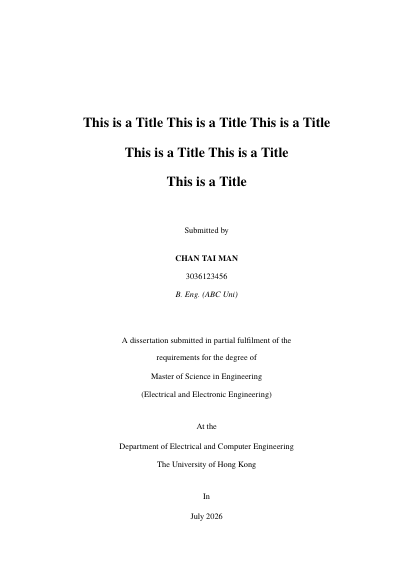

# HKU MSc Dissertation LaTeX Template

An unofficial LaTeX template for the HKU MSc Final Report / Dissertation, strictly following the formatting of the official Word template.

The official Word template (author: Dr. Andrew Ho Chun Wu, updated 18 April 2026) is available [on Google Docs](https://docs.google.com/document/d/1-CYaa02tVP_KbrOG3NTDs8q2SehJ-lYF/edit?usp=sharing&ouid=107516997935154803843&rtpof=true&sd=true) and in the `Documentation/` folder of this repository.

---

## Preview

A compiled v1.3.2 sample is available at [Documentation/main-preview-v1.3.2.pdf](Documentation/main-preview-v1.3.2.pdf).


> Note for Cover Page: "B. Eng. (ABC Uni) " --> 
Put down your 1st degree, with the abbreviation of the name of your university.

---

## File Structure

```
.
├── main.tex                       ← Master file (document body only — no editing needed)
│
├── Config/
│   └── config.tex                 ← All packages & global settings
│
├── Preliminary/
│   ├── cover.tex                  ← ★ Thesis details + cover page (EDIT THIS)
│   ├── abstract.tex               ← Abstract
│   ├── declaration.tex            ← Declaration of authorship
│   ├── acknowledgment.tex         ← Acknowledgements
│   └── symbols.tex                ← List of symbols
│
├── Chapters/
│   ├── chapter01.tex              ← Chapter 1: Introduction
│   ├── chapter02.tex              ← Chapter 2: Literature Review
│   ├── chapter03.tex              ← Chapter 3: Proposed Methodology
│   ├── chapter04.tex              ← Chapter 4: Experimental Results
│   └── chapter05.tex              ← Chapter 5: Conclusion
│
├── Figures/
│   └── Signature.png              ← Replace with your own signature image
│
├── Documentation/                 ← Official Word template + sample PDF
├── references.tex                 ← Bibliography entries (IEEE style)
├── appendices.tex                 ← Appendix chapters
└── .latexmkrc                     ← Forces XeLaTeX for latexmk / Overleaf
```

---

## Quick Start

### 1. Edit Your Thesis Details

Open **`Preliminary/cover.tex`** — this is the only file you need to edit for your personal details:

```latex
\newcommand{\ThesisTitle}{Your Thesis Title Here}
\newcommand{\AuthorName}{YOUR NAME}
\newcommand{\StudentID}{3036XXXXXX}
\newcommand{\PreviousDegree}{B.Eng.~(Your University)}
\newcommand{\DegreeName}{Master of Science in Engineering}
\newcommand{\Specialisation}{(Your Specialisation)}
\newcommand{\Department}{Your Department}
\newcommand{\SupervisorName}{Prof. Your Supervisor}
```

`\SubmissionDate` updates **automatically** on every compile (e.g. `April 2026`).

### 2. Set the Compiler to XeLaTeX

This template **requires XeLaTeX** (for `fontspec` / Times New Roman). pdfLaTeX will not work out of the box.

| Platform     | How to set XeLaTeX                        |
|--------------|-------------------------------------------|
| **Overleaf** | Menu (top-left) → Compiler → **XeLaTeX**  |
| **Prism** (***shutting down on January 1, 2027***) | XeLaTeX is the default — no change needed; export your projects before shutdown |
| **[inscrive.io](https://inscrive.io)** | Project settings → LaTeX engine → **XeLaTeX**; use `main.tex` as the main document |
| **Local**    | Run `latexmk -shell-escape main.tex` (the included `.latexmkrc` selects XeLaTeX automatically); Inkscape must be installed for the SVG example |

`main.tex` also starts with `% !TEX program = xelatex`, which inscrive.io supports for engine selection. You can import the project from a ZIP or through its Git integration. See [inscrive.io's migration and compiler guide](https://inscrive.io/articles/migrate-from-overleaf).

OpenAI has [announced Prism's shutdown](https://openai.com/index/introducing-prism/). inscrive.io is an alternative editor for this template; Overleaf and local XeLaTeX remain supported.

> **pdfLaTeX fallback (not recommended):** replace the "Font" section of `Config/config.tex` with the lines below and delete `.latexmkrc`:
>
> ```latex
> \usepackage[utf8]{inputenc}
> \usepackage[T1]{fontenc}
> \usepackage{times}
> ```

### 3. Compile

On **Overleaf / inscrive.io / Prism (before shutdown)**, click Compile with XeLaTeX selected. Locally, run `latexmk -shell-escape main.tex` with Inkscape installed. Repeated LaTeX passes are needed for the contents, lists and cross-references; `latexmk` runs these automatically. If references still show as `??`, compile again after fixing any errors.

The bundled SVG example uses `svg` and Inkscape to generate PDF + LaTeX files during compilation. A fresh build needs Inkscape and shell escape enabled; cached SVG output alone does not verify a fresh conversion.

### 4. Write Your Content

- Edit chapter files in `Chapters/`
- Add references to `references.tex`
- Place figure files in `Figures/`
- Edit the list of symbols in `Preliminary/symbols.tex`

---

## Formatting Specifications

These match the official Word template (note: this is the department's house style — it is neither APA nor IEEE page geometry, although references follow IEEE citation style).

| Property        | Value                                        |
|-----------------|----------------------------------------------|
| Paper           | A4                                           |
| Margins         | L=3.17cm R=3.17cm T=2.54cm B=2.54cm          |
| Font            | Times New Roman 12pt when installed; TeX Gyre Termes fallback (via `fontspec`) |
| Line spacing    | Double (2.0)                                 |
| Chapter heading | 16pt bold                                    |
| Section heading | 14pt bold                                    |
| Subsection      | 12pt bold italic                             |
| Header/Footer   | Chapter title in header with 0.4pt rule; centred page number in footer |
| Numbering       | Chapter-based: Table 2.1, Fig. 2.1, Eq. (2.1) |
| References      | IEEE citation style, numbered `[1]`          |

---

## Dates

| Location              | Command               | Example Output  |
|-----------------------|-----------------------|-----------------|
| Cover page            | `\monthandyear\today` | April 2026      |
| Declaration signature | `\fulldate\today`     | 28th April 2026 |

Both auto-update on every compile via the `datetime` package in `Config/config.tex`.

---

## Adding a New Chapter

1. Create `Chapters/chapter06.tex`
2. Add `\input{Chapters/chapter06}` in `main.tex` after `chapter05`

---

## Adding References

Add entries to `references.tex` in IEEE format:

```latex
\bibitem{key}
A.~Author, ``Title of paper,''
\emph{Journal Name}, vol.~X, no.~Y, pp.~Z--ZZ, 2026.
```

Cite in text with `\cite{key}`.

---

## Signature Image

Replace `Figures/Signature.png` with your own signature (transparent PNG, ~500 px wide recommended). It overlays the signature line in `Preliminary/declaration.tex`. To use a plain underline instead, comment out the `tikzpicture` block in that file.

---


## Notes

- The compiler must be **XeLaTeX** — pdfLaTeX will fail due to `fontspec`.
- The template uses Times New Roman when the compiler can find it; otherwise it automatically falls back to TeX Gyre Termes. Verification on inscrive.io with XeLaTeX and TeX Live 2026 used TeX Gyre Termes. Check the compiled font against your department's requirements if Times New Roman is mandatory.
- Page breaks are permitted between consecutive headings (a small patch in `Config/config.tex`), so a draft full of empty placeholder sections still paginates correctly.

## v1.3.2 Compatibility Update

- Separate uppercase contents/list titles from their font declarations for compatibility with newer `tocloft` versions.
- Keep SVG inclusion and disable the unused `transparent` package through `svg`'s `notransparent` option for XeLaTeX. Partially transparent SVG text needs separate handling; the bundled example is opaque.
- Move the example table's label after its caption so `\ref{tab:example}` resolves to the correct table.
- Add the XeLaTeX engine directive and inscrive.io setup instructions, and mark Prism's retirement date.

Verified on inscrive.io with XeLaTeX and TeX Live 2026: no compilation errors or warnings were reported. The compiled result is included in `Documentation/main-preview-v1.3.2.pdf`.

When migrating an existing project, start with a fresh project or clear generated build files, then check the contents, List of Tables, List of Figures, Table 2.1 reference, and SVG figure.

## Open the project on Overleaf (GitHub is always the latest)

[](https://www.overleaf.com/latex/templates/hku-msc-dissertation-latex-template/wngqqydtxhtz)

==================

 PULL REQUESTS
 
==================

https://github.com/devicu-awsl/hku-thesis-template.git
